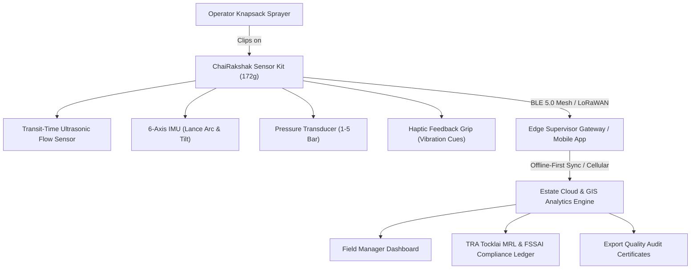

# ChaiRakshak: Smart Monitoring of Manual / Operator-Carried Spraying
### NESFIC-I-06 | North East Seva First Innovation Challenge 2026
**Assam Innovation & Startup Foundation (AISF) | Partner: Tea Research Association (TRA) Tocklai**

[](https://vitejs.dev/)
[](https://react.dev/)
[](https://tailwindcss.com/)
[](LICENSE)

---

## 🍃 Overview
In tea plantations across Assam and the Dooars, crop protection against pests (Tea Mosquito Bug, Red Spider Mite, Looper) and fungal pathogens (Blister Blight) relies on manual, operator-carried knapsack and motorized sprayers. 

**ChaiRakshak** is an innovative, non-invasive IoT retrofitting and digital twins platform that transforms operator-carried spraying into a precision-guided, auditable operation:
- **Ultrasonic Transit-Time Flow Sensing:** Non-intrusive piezo-ceramic sensor measuring discharge (mL/min) with ±1.5% accuracy, immune to chemical slurry clogging.
- **6-Axis Kinematic IMU:** Evaluates lance sweeping arc, bush canopy height (optimal 30–45 cm), and elevation angle.
- **Haptic Grip Feedback:** Provides discreet vibration cues directly on the operator's lance handle to maintain optimal pace (2.0–2.4 km/h) without needing to look at screens.
- **TRA Tocklai & FSSAI Compliance:** Real-time spatial swath calculation ($L/ha$) preventing under-spraying (<350 L/ha) and over-spraying (>500 L/ha) to safeguard European Union / FSSAI Maximum Residue Limits (MRL).
- **Offline-First Mesh Sync:** Semtech SX1262 LoRaWAN + BLE 5.0 mesh buffering telemetry in remote tea gardens with zero mobile network.

---

## 🚀 Live Demo & Development

### Prerequisites
- Node.js (v18+)
- npm or yarn

### Quick Start
```bash
# Clone the repository
git clone https://github.com/RonHatibaruah/nesfic-i06-smart-spray-monitoring.git
cd nesfic-i06-smart-spray-monitoring

# Install dependencies
npm install

# Start development server
npm run dev
```

Visit `http://localhost:5173` (or the indicated port) in your browser.

---

## 🛠️ System Architecture



---

## 📊 Modules & Features
1. **Field Operations Live Map:** Real-time spatial swath tracking with color-coded bush row coverage (green = optimal, blue = under-spray, red = over-spray).
2. **Lance Kinematics & Ultrasonic Flow:** Non-intrusive flow rate, pressure, and lance elevation monitoring.
3. **TRA Dosage & MRL Safety:** Automatic Pre-Harvest Interval (PHI) plucking lockout and certified export audit log generation.
4. **Hardware Retrofit Kit Specs:** Low-power ESP32-S3 dual-core microcontroller, multi-constellation NavIC/GPS, and LiFePO4 battery (18+ hours runtime).
5. **NESFIC-I-06 Proposal Dossier:** Complete 12-section proposal aligned with AISF requirements, 9 16:9 blueprint infographics, and two standalone downloadable PDFs (`NESFIC_I06_Proposal.pdf` & `NESFIC_I06_Proof_of_Work.pdf`).

---

## 💰 Indicative Resource & Budget Allocation (₹40.00 Lakhs Grant)

| Budget Head | Scope & Deliverables | Allocation | Share |
| :--- | :--- | :---: | :---: |
| **Technical Engineering Team Cost** | 6-month multi-disciplinary team (Lead Architect, Embedded/Firmware, RF/LoRa, Cloud/GIS, Tea Agronomist, Field QA) | **₹20.00 Lakhs** | **50.0%** |
| **Hardware Prototyping & Pilot Batch** | 100 retrofit kits (ESP32-S3, piezo ultrasonic, NavIC, IMU, LiFePO4), solar LoRaWAN gateways, PCB runs | ₹7.50 Lakhs | 18.75% |
| **Mechanical Tooling & IP67 Enclosures** | Rapid injection-mold tooling, UV-polycarbonate housings, FKM chemical seals, universal lance clamps | ₹4.00 Lakhs | 10.0% |
| **Field Pilot Validation (TRA Tocklai)** | 50-hectare Assam trials, Water-Sensitive Paper (WSP) consumables, operator workshops (Sadri/Assamese) | ₹4.00 Lakhs | 10.0% |
| **Cloud, IP & Regulatory Compliance** | AWS/PostGIS hosting, WPC 865 MHz & IP67 lab certifications, provisional patents, FSSAI/TRA audit tooling | ₹2.50 Lakhs | 6.25% |
| **Contingency & Operational Reserve** | Component lead-time buffers, monsoon trial rescheduling, and field replacement spares | ₹2.00 Lakhs | 5.0% |
| **Total Problem Statement Grant** | **Complete 6-Month TRL-7 Execution & Validation** | **₹40.00 Lakhs** | **100.0%** |

---

## 📜 License & Attribution
- **Organization:** TeaTech Labs (`© 2026 TeaTech Labs. All Rights Reserved.`)
- **Lead Applicant:** Rangan Bhuyan
- **Challenge:** North East Seva First Innovation Challenge (NESFIC 2026) — Problem Statement `NESFIC-I-06`
